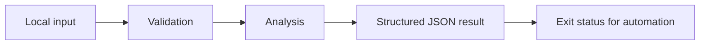

# Config Drift Review

Deterministic JSON configuration diffs with JSON Pointer paths and exact exclusions.

A focused Python command-line project with synthetic examples, explicit behavior, and regression tests. It runs locally without credentials or third-party packages.

## Run it

Requires Python 3.11 or newer.

```sh
python3 drift.py sample.json --ignore /metadata
python3 -m unittest -v
```

See [VALIDATION.md](VALIDATION.md) for the actual local test output and example result. GitHub Actions runs the suite on Python 3.11, 3.12, and 3.13.

## Design

The tool recursively compares objects, emits deterministic sorted paths, and treats arrays as atomic values so reordering stays visible. JSON Pointer escaping keeps slash and tilde keys unambiguous. Exclusions match an exact path and its subtree; /a does not suppress /ab. Scalar type changes are explicit, including boolean versus integer. Exit 1 means differences exist; exit 2 means input failure.



## Scope and limitations

This compares supplied snapshots and performs no live infrastructure discovery or remediation. Arrays are order-sensitive. It does not resolve provider defaults, computed fields, or semantic numeric equivalence. Reports include changed values; keep sensitive configuration out of public reports. No secrets are included in the synthetic sample.

## Project layout

- `drift.py`: core functions and command-line entry point.
- `test_drift.py`: behavioral tests, including invalid inputs and boundary cases.
- `sample.json`: fictional example input or example notes.
- `VALIDATION.md`: reproducible local validation record.
- `.github/workflows/tests.yml`: automated tests with read-only repository permissions.

The core functions can be imported independently of the command line. Input files are never modified. Sample data is synthetic; the repository does not claim production usage or customer results.

MIT licensed.
